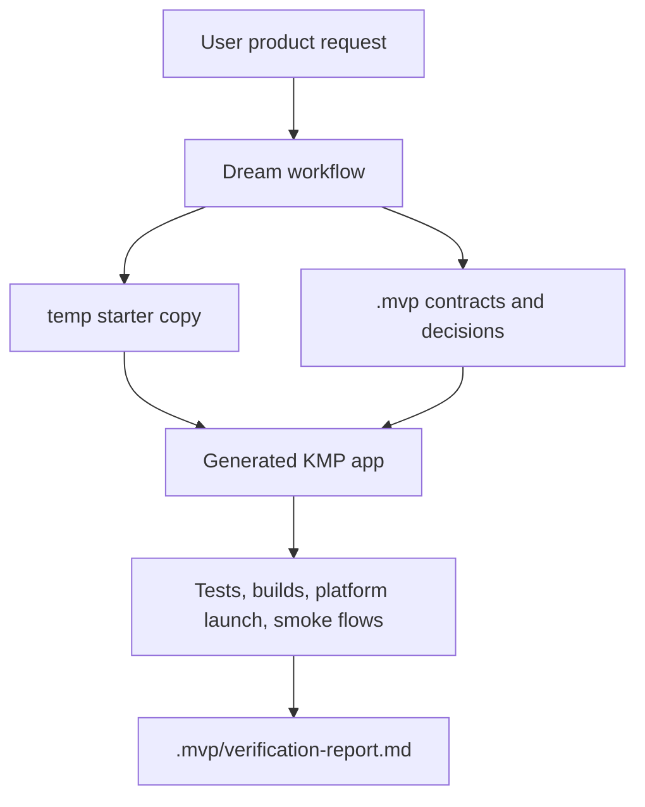
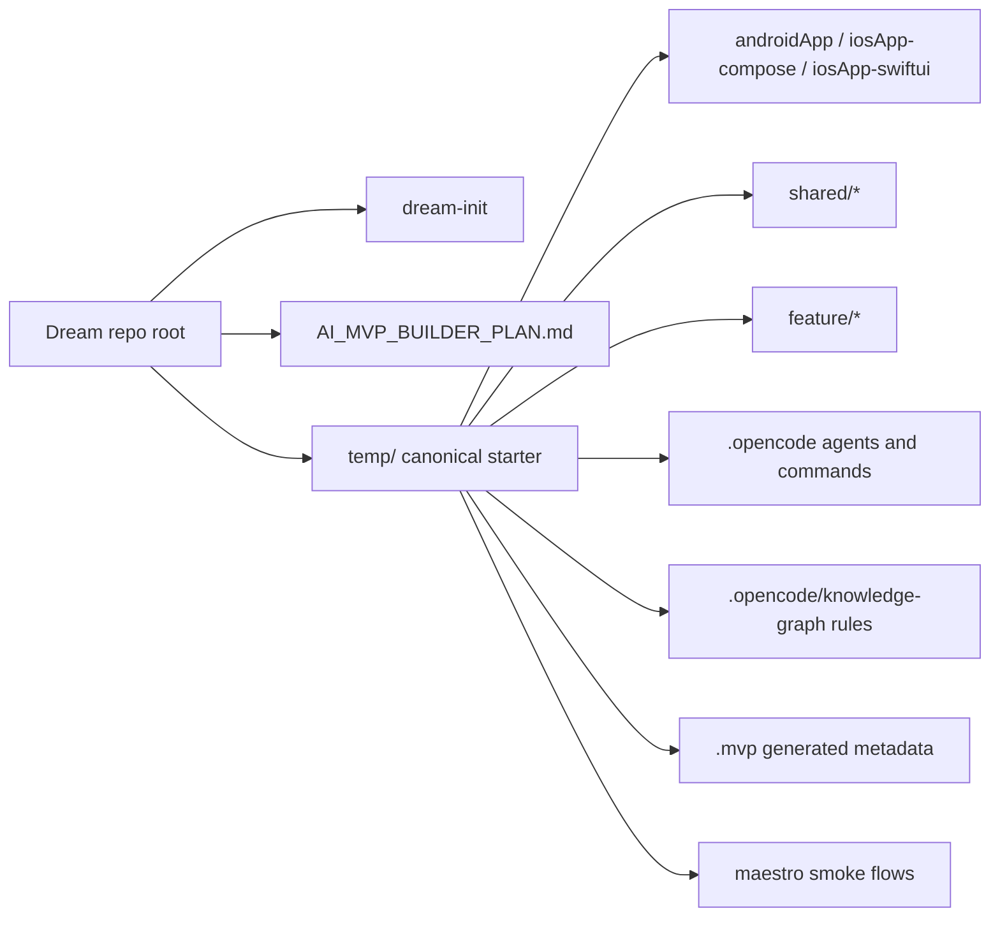
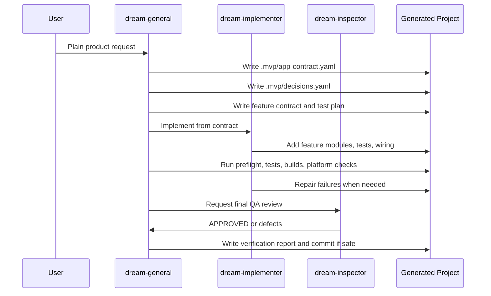
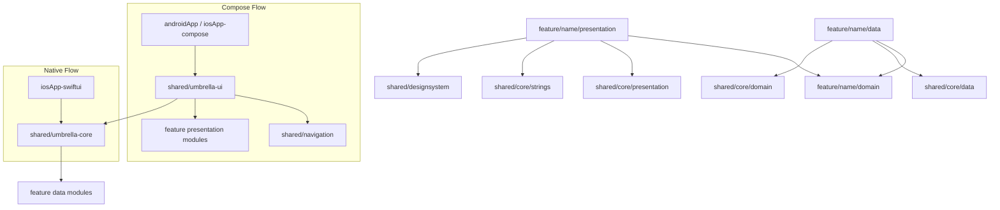
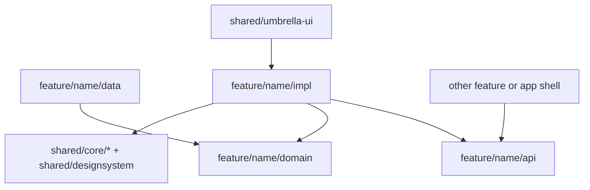
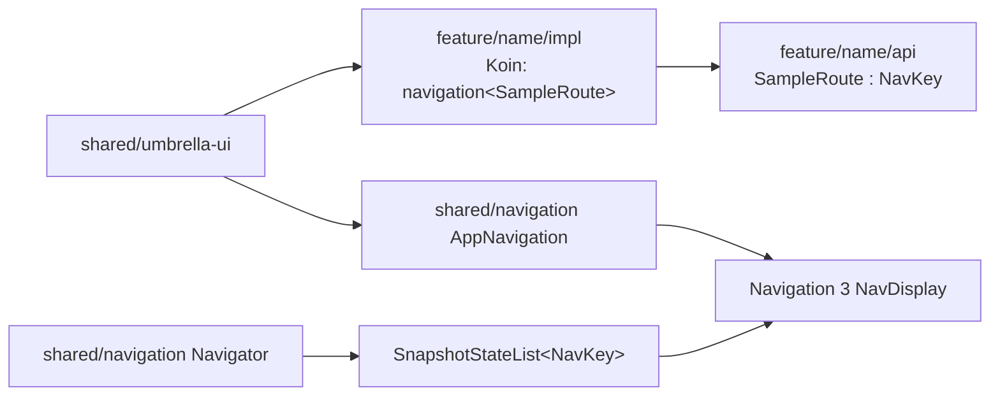
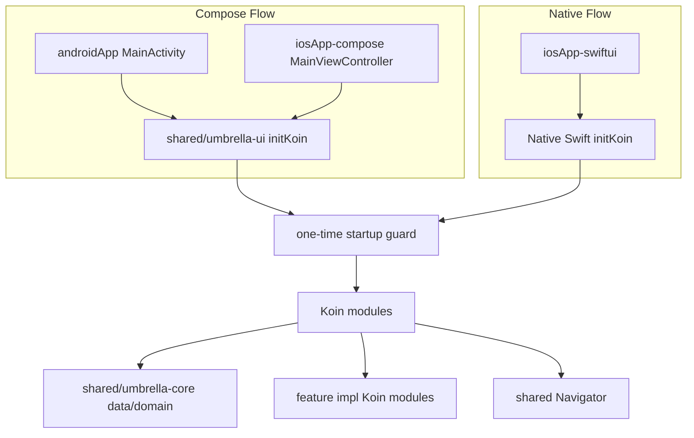
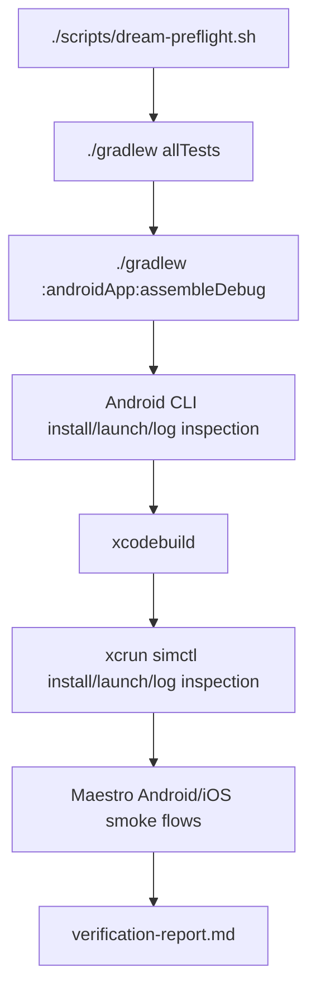

# Dream Onboarding

Dream is a local-first AI production-app builder for Kotlin Multiplatform apps. It packages a reusable starter project, OpenCode agents, architecture guidance, verification rules, and smoke-test scaffolding so a natural-language product request can become a modular Android and iOS app.

Use this document when you are new to the repository and need to understand how Dream is built, how the workflow runs, and why the template is shaped this way.

## Mental Model

Dream is not a single generated app. Dream is the tool and starter baseline that creates generated apps.

The repository centers on `temp/`, which is the canonical starter project copied by the initializer. Generated app work should happen in `temp/` or in a copy created from `temp/`, not in unrelated root-level Gradle surfaces.



## Repository Map

- `dream-init`: initializer entry point that copies and renames `temp/`.
- `AI_MVP_BUILDER_PLAN.md`: compact product tracker and current priorities.
- `AGENTS.md`: repository-level working rules for agents and contributors.
- `ONBOARDING.md`: this entry-level guide.
- `temp/`: canonical Kotlin Multiplatform starter project.
- `temp/.opencode/`: packaged OpenCode config, agents, commands, and prompt guidance.
- `temp/.opencode/knowledge-graph/`: reusable architecture rules and retrieval sources.
- `temp/.mvp/`: generated contracts, decisions, feature reports, and verification reports.
- `temp/maestro/`: Android and iOS smoke-flow scaffolding.
- `temp/scripts/dream-preflight.sh`: local readiness check for git, Android SDK, and Maestro.



## Why `temp/` Exists

`temp/` is a complete starter app plus the agent layer needed to evolve it. The initializer should only copy `temp/`, rename it, apply deterministic identity rewrites, and hand the result to OpenCode. Feature generation, repair, verification, and review happen after the copy exists.

This keeps Dream local-first and reproducible:

- starter structure is versioned in one place
- generated apps inherit the same architecture rules
- agents and commands travel with the generated project
- verification expectations are available inside the generated project

## Generation Workflow

Dream follows a contract-first flow. Code should not be generated before the relevant contract exists.



Required generated artifacts:

- `.mvp/app-contract.yaml`
- `.mvp/decisions.yaml`
- `.mvp/features/<feature>/contract.yaml`
- `.mvp/features/<feature>/test-plan.md`
- `.mvp/features/<feature>/implementation-report.md`
- `.mvp/verification-report.md`

## Architecture Rules

Dream keeps generated apps modular so they can grow without collapsing into host-app code.

Non-negotiable rules:

- keep host apps thin
- place product behavior in feature modules
- preserve `Presentation -> Domain <- Data`
- keep domain pure Kotlin
- keep navigation centralized
- keep user-visible strings in shared resources
- use Dream design-system components and `DreamTheme` tokens before raw Material3 or ad hoc feature-local UI primitives
- validate Android, iOS, and contract-selected Desktop as real product targets



## Feature Modules

Generated features use this shape:

- `feature/<name>/domain`: domain models, repository interfaces, use cases, pure business contracts
- `feature/<name>/data`: Room/network/local implementations, entities, mapping, repository implementations
- `feature/<name>/api`: public navigation contract — `NavKey` route types and any minimal public types callers need to navigate to this feature
- `feature/<name>/impl`: full feature implementation — screens, ViewModels, UI state/actions/events, presentation mappers, and the Koin module that installs Navigation 3 entry providers

For multi-word feature concepts, keep folders, Gradle module names, and Kotlin packages aligned. Prefer package-mirroring directories such as `feature/expense/details` with `feature.expense.details`, or use a single slug consistently everywhere. Avoid mixed conventions such as a `feature/expense-details` folder with `feature.expense.details` packages.



Why this shape:

- domain can be tested without platform dependencies
- data depends on domain contracts rather than leaking persistence upward
- `api` keeps the public navigation contract small and stable; callers never need to know about implementation details
- `impl` can be refactored or replaced without changing any caller
- cross-feature navigation is enforced at the module boundary — depending on `impl` is a build error for other features

Feature reuse rules:

- other features and the app shell depend on `feature/<name>/api` only, never on `feature/<name>/impl`
- domain-only reuse can be valid for aggregators or clearly dependent workflows
- cross-feature data implementation reuse is an explicit MVP exception, not the default
- extract to `shared/*` when multiple features equally own the same persisted concept or reusable behavior

Design-system rule:

- feature UI should use `shared/designsystem` components for common buttons, text fields, cards, dialogs, sheets, lists, navigation chrome, progress, feedback, and selection controls
- raw Material3 components are allowed only when no design-system wrapper exists or a wrapper lacks required behavior
- document raw Material3 exceptions and consider adding a shared wrapper when the need is reusable

## Navigation

Dream uses Navigation 3 with centralized navigation display and feature-owned typed route keys.

Rules:

- route types live in `feature/<name>/api` and implement `androidx.navigation3.runtime.NavKey`
- `feature/<name>/impl` installs Navigation 3 entry providers using `navigation<Route> { FeatureScreen() }` in its Koin module
- `shared/navigation` owns the `NavKey` back stack and renders it with `NavDisplay`; it has no knowledge of feature-specific types
- `shared/umbrella-ui` imports feature `impl` Koin modules so all navigation installers are registered before `NavDisplay` renders
- other features or the app shell navigate by depending on `feature/<name>/api` for the route type only



This replaced the older shared `AppRoute` pattern and a single `presentation` module holding both routes and screens, because the public navigation contract and implementation details should live in separate modules.

## Dependency Injection

Dream uses Koin with a composition-root mindset.

Rules:

- host apps call the shared guarded startup helper
- features contribute modules, but do not start Koin themselves
- generated feature code uses Koin compiler-plugin DSL registrations
- avoid annotation-based DI such as `@KoinViewModel`, `@Module`, and `@ComponentScan` unless explicitly requested
- retrieve ViewModels at stable navigation/composition boundaries



## Storage

The starter demonstrates local-first persistence with KMP Room.

Important defaults:

- Room builder policy is centralized in `shared/core/data`.
- The bundled SQLite driver is configured once.
- Room query execution uses `Dispatchers.Default` for KMP-safe behavior.
- First-pass MVP iteration uses destructive migration fallback to recover from stale local test schemas.
- Real apps that need to preserve user data must replace destructive fallback with migrations.

## Testing

Generated features should include tests by layer.

- domain tests for models, value rules, and repository contracts
- data tests for entity mapping and repository behavior using fake DAO/database boundaries where possible
- presentation tests for loading, empty, content, error, actions, and events
- ViewModel tests use reusable dispatcher setup with `@BeforeTest` and `@AfterTest`
- Turbine is available for flow and state transition assertions
- time-sensitive tests should use `FakeTimeProvider` and readable `kotlinx-datetime` construction

## Verification

Dream treats verification as a ladder, not a single build command.



Run from `temp/` or from a generated copy:

```bash
./scripts/dream-preflight.sh
./gradlew allTests
./gradlew :androidApp:assembleDebug
```

Feature-owned smoke flows live under `maestro/features/<feature-name>/`:

```bash
maestro test maestro/features/sample/android.yaml
maestro test maestro/features/sample/ios.yaml
```

Every user-visible generated feature should have at least one Android smoke flow and one iOS smoke flow when the feature is supported on that platform. App-level startup smoke checks may exist, but they do not replace feature-level coverage.

Verification reports must distinguish:

- `passed`
- `blocked by environment`
- `not run`
- `not applicable`

Use `temp/.opencode/guidance/templates/verification-report-template.md` for the report shape.

## Working With The Starter

When adding or replacing a feature:

1. Create or update the feature contract first.
2. Add `feature/<name>/domain`, `feature/<name>/data`, `feature/<name>/api`, and `feature/<name>/impl` as needed.
3. Add feature `NavKey` route types in `api`.
4. Add screens, ViewModels, and Koin navigation entry installers in `impl`.
5. Register data/domain dependencies through Koin modules in `impl`; do not put Koin definitions in `api`.
6. Add shared string resources before writing UI copy.
7. Add tests by layer.
8. Update Maestro smoke scaffolding for the user-visible journey.
9. Run preflight and verification.
10. Write reports using the templates under `temp/.opencode/guidance/templates/`.
11. Only commit when verification and review are clean and staging is safe.

Use `temp/.opencode/guidance/new-feature-checklist.md` as the operational checklist.

## Sample Feature Policy

`feature/sample` exists as starter scaffolding. It is useful for demonstrating module shape, Room, strings, ViewModel tests, navigation, and DI.

Once a real first feature replaces it in a generated app, remove sample leftovers:

- `feature/sample` modules
- settings includes
- sample DI registrations
- sample route keys and navigation entries
- sample strings and docs text
- sample database names and Room schema exports

The current template guidance explicitly calls out these cleanup checks because leftover sample artifacts were a source of review drift in the first generated-app run.

## Updating Dream Itself

When changing Dream rather than a generated app:

- update `AI_MVP_BUILDER_PLAN.md` if workflow, priorities, or success criteria change
- update `temp/.opencode/guidance/prompts/` when generation or verification behavior changes
- update `temp/.opencode/knowledge-graph/best-practices/` when architecture rules change
- update `temp/README.md` and `temp/AGENTS.md` when starter structure or validation commands change
- keep root docs compact and link to detailed guidance rather than duplicating every rule

## Current Follow-Ups

- Run a fresh generated-project flow to verify the hardening changes eliminate first-run drift in practice.
- Keep sample schema exports only as starter scaffolding; remove them when a generated app replaces `feature/sample`.
- Continue tightening identity normalization during project instantiation.
